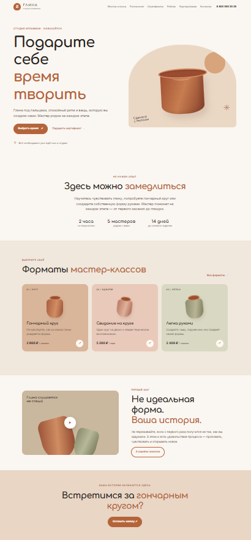
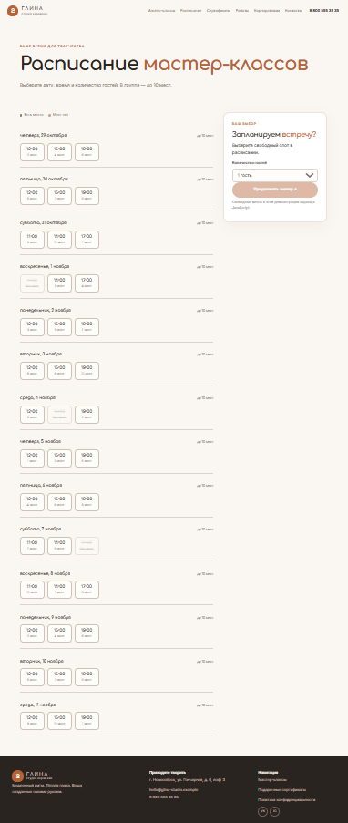
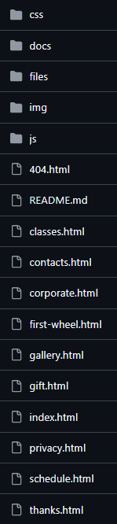
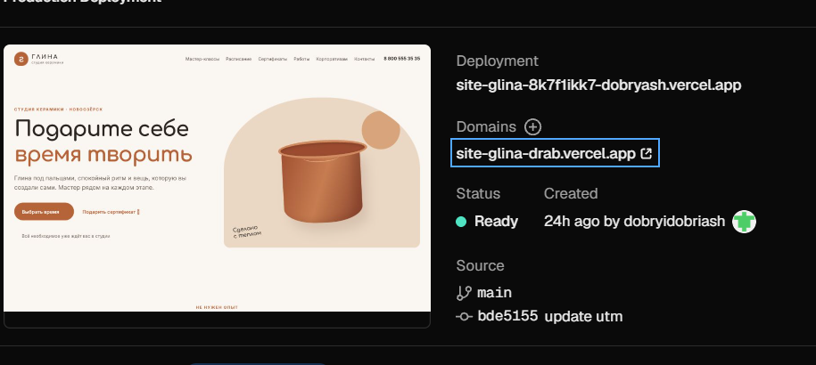
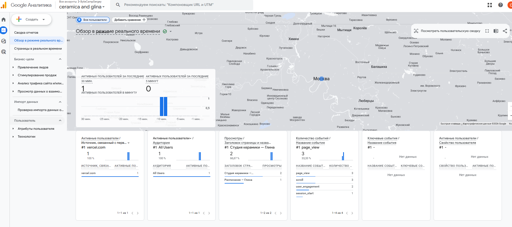
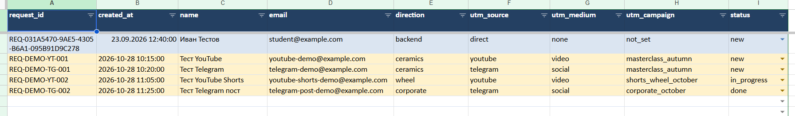

# ГЛИНА — сайт студии керамики

Учебный проект сайта студии керамики «Глина». Сайт знакомит посетителей с мастер-классами, расписанием занятий, подарочными сертификатами и работами студии, а также содержит формы для оформления заявки и демонстрационные инструменты аналитики.

## Ссылки

- **Сайт:** [открыть сайт](https://site-glina-8k7k7k-dobyash.vercel.app/) <!-- проверьте актуальность адреса перед публикацией -->
- **Репозиторий:** добавьте ссылку на свой GitHub-репозиторий.
- **Демо-развёртывание:** см. скриншот [Vercel](screens/vercel-deployment.png).

## Скриншоты

### Главная страница



### Расписание мастер-классов



### Структура проекта на GitHub



### Развёртывание на Vercel



### Google Analytics



### Отчёт GA4 по лидам



### Telegram


> Скриншоты показывают предоставленные материалы проекта. Подтверждайте реальные события и заявки только данными из подключённых сервисов; демонстрационные формы и события не следует считать подтверждёнными сервером заявками.

## Возможности сайта

- Главная страница с описанием студии.
- Страницы мастер-классов и форматов занятий.
- Расписание с выбором даты и временного слота.
- Подарочные сертификаты с интерактивным предпросмотром.
- Галерея работ с увеличенным просмотром.
- Корпоративные предложения.
- Контактная страница и форма заявки.
- Страница успешного завершения демонстрационной заявки.
- Адаптивная навигация для мобильных устройств.
- Метаданные для поисковых систем и Open Graph-превью.
- Клиентская аналитика событий и поддержка UTM-меток.

## Используемые технологии

- **HTML5** — структура страниц.
- **CSS3** — стили, сетки и адаптивная вёрстка.
- **JavaScript** — интерактивность, калькулятор, расписание, галерея и формы.
- **Google Analytics 4 (GA4)** — предусмотрена отправка аналитических событий при корректной настройке идентификатора.
- **Vercel** — развёртывание сайта (по предоставленному скриншоту).

## Структура проекта

```text
Site/
├── index.html              # Главная страница
├── classes.html            # Мастер-классы
├── schedule.html           # Расписание
├── gallery.html            # Галерея работ
├── gift.html               # Подарочные сертификаты
├── corporate.html          # Корпоративные предложения
├── contacts.html           # Контакты и форма
├── thanks.html             # Страница подтверждения
├── privacy.html            # Политика конфиденциальности
├── 404.html                # Страница ошибки 404
├── css/
│   └── style.css           # Стили сайта
├── js/
│   ├── main.js             # Основная логика интерфейса
│   ├── form.js             # Точка настройки интеграции формы
│   └── analytics.js        # UTM-атрибуция и аналитика
├── img/
│   ├── favicon.svg
│   └── og-cover.svg
├── files/
│   └── corporate-presentation.pdf
└── docs/
    ├── events.md           # Реестр аналитических событий
    ├── guide-code.md       # Объяснение структуры кода
    ├── images.md           # Информация об изображениях
    ├── prompts.md          # Материалы проекта
    ├── report.md           # Шаблон аналитической записки
    ├── social-buttons.html # Пример кнопок соцсетей
    └── utm.csv              # Примеры UTM-меток
```

## Запуск локально

1. Скачайте или клонируйте репозиторий.
2. Откройте `index.html` в браузере либо запустите локальный статический сервер.
3. Перейдите по страницам через основное меню.
4. Проверьте формы, калькулятор, расписание и галерею в браузере.

Для локального запуска сборка и установка npm-зависимостей по представленным файлам не требуются.

## Аналитика и формы

В проекте предусмотрены UTM-метки и события взаимодействия, включая клики по CTA, выбор формата занятия и слота, взаимодействие с сертификатом и отправку формы.

Перед использованием в production необходимо:

- указать действительный идентификатор потока GA4 в соответствии с настройками проекта;
- проверить события в DebugView;
- настроить реальный приём заявок на сервере или через Google Apps Script;
- убедиться, что UTM-параметры сохраняются в целевой таблице или CRM;
- не передавать в Google Analytics персональные данные, например имя, телефон или e-mail;
- обновить ссылки на социальные сети и проверить согласия пользователя и политику конфиденциальности.

**Важно:** по исходным файлам форма описана как демонстрационная. Наличие кода аналитики само по себе не подтверждает, что события поступают в GA4, а заявки сохраняются в Google Таблице. Проверьте интеграции перед тем, как заявлять об их полноценной работе.

## Скриншоты-доказательства

Изображения для README хранятся в каталоге [`screens/`](screens/). При переносе README в репозиторий загрузите каталог `screens` вместе с файлом, чтобы относительные ссылки на изображения отображались корректно.

## Статус проекта

Базовая версия сайта подготовлена. Реальную работу внешних интеграций, отправку заявок и показатели аналитики следует подтверждать тестированием подключённых сервисов.

---

*README составлен по предоставленным файлам сайта и скриншотам. Перед публикацией проверьте URL сайта, ссылки на репозиторий и актуальность скриншотов.*
